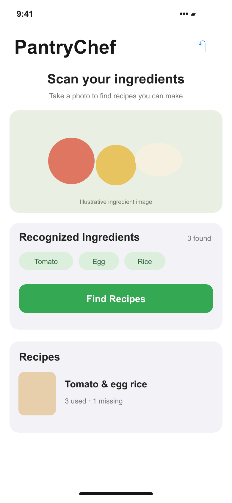
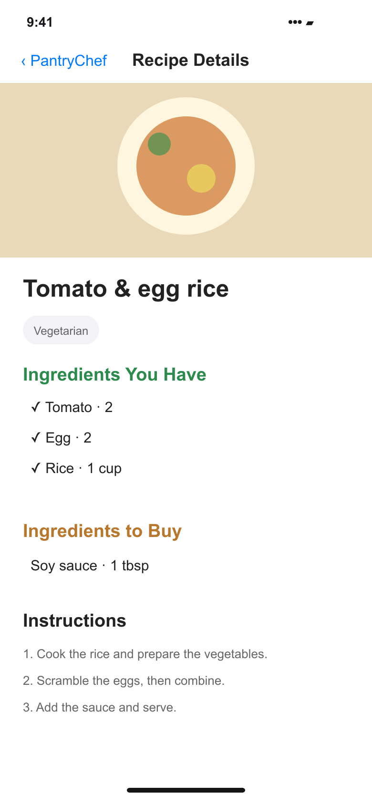

# Portfolio screens

Prepared for the Davin Cuaso portfolio on 6 November 2026.

These are source-based interface recreations with fictional sample data. They are not screenshots from a running native app or backend. Camera scenes and ingredient illustrations are schematic; measurements, saved places, and study statistics are sample content.

The SVG files are editable masters; PNG files are opaque exports.

## Ingredient review and recipes

Source: [PantryChef/Views/ContentView.swift](https://github.com/davincuaso/PantryChef/blob/35de6c2374cdc672c63899cb320fb48b13440573/PantryChef/Views/ContentView.swift), [PantryChef/Views/RecipeRowView.swift](https://github.com/davincuaso/PantryChef/blob/35de6c2374cdc672c63899cb320fb48b13440573/PantryChef/Views/RecipeRowView.swift).

## Recipe detail

Source: [PantryChef/Views/RecipeDetailView.swift](https://github.com/davincuaso/PantryChef/blob/35de6c2374cdc672c63899cb320fb48b13440573/PantryChef/Views/RecipeDetailView.swift).

